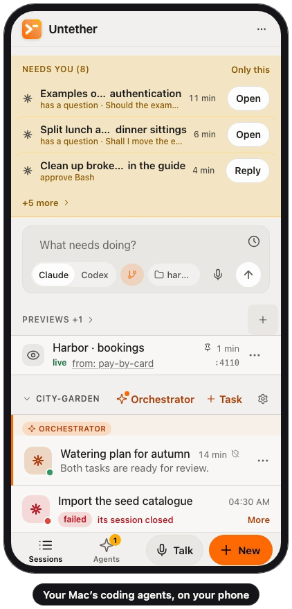
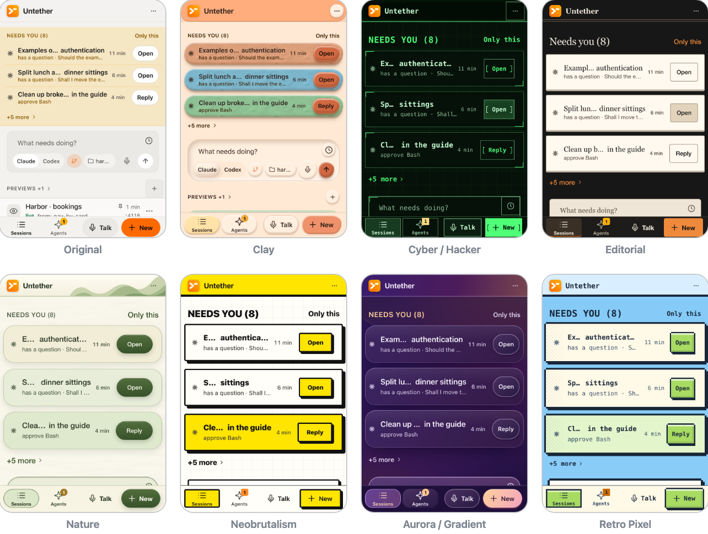
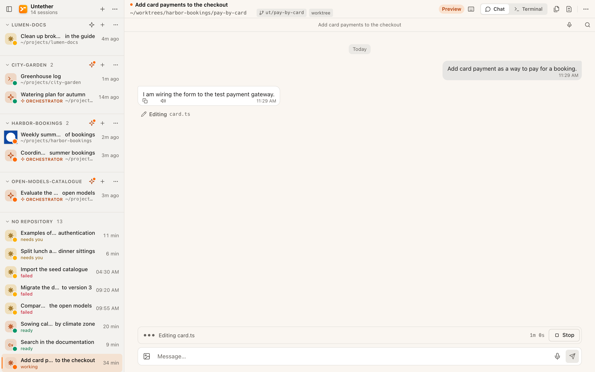
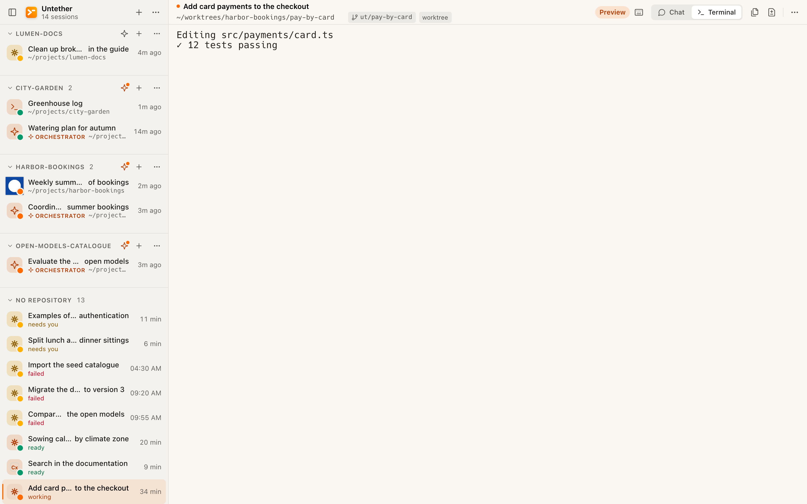

<h1 align="center">
  <br>
  Untether
</h1>

<p align="center">
  <b>The coding agents running on your Mac, on your phone.</b><br>
  Follow and answer Claude Code and Codex sessions from any browser, and hand them tasks that get
  reviewed, checked and merged on their own.
</p>

<p align="center">
  <a href="LICENSE"></a>
  
  
</p>

<p align="center">
  <picture>
    <source media="(prefers-color-scheme: dark)" srcset="docs/readme/untether-dark.gif">
    
  </picture>
</p>

<p align="center"><sub>
  Recorded from the real interface on the test twin (<code>scripts/gemelo.sh</code>): made-up projects, no agent running.
  How it was made, and what in it is staged: <a href="web/scripts/readme-media.mjs"><code>web/scripts/readme-media.mjs</code></a>.
</sub></p>

## What it does

- **Your Mac's sessions, on your phone.** A menu bar app runs a local server; its web interface
  lists every Claude Code, Codex or shell session by project and puts on top the ones that need
  you (a permission, a question, a failure). Open one as a terminal or as a chat and answer.
- **Tasks that merge themselves.** `ut task new "…"` starts an agent in its own git worktree and
  branch. When it reports done, an AI reviewer reads the diff and your project's check command
  runs; if both pass and nothing is flagged as risky, the branch is merged (or waits for your OK:
  a setting per project). What fails goes back to the agent; what needs a decision waits for you.
- **Interface styles.** 25 of them, from the plain Original to Clay, Cyber / Hacker or Retro
  Pixel, picked per device in Settings. [Some of them](#interface-styles) below.
- **Safe by design.** Signing in gives a shell on your Mac, so the server listens on the Mac only
  until you say otherwise, and the recommended way to reach it from outside is
  [Tailscale](https://tailscale.com) Serve: HTTPS, inside your own tailnet, your own Tailscale
  user only. The whole picture is in [docs/security.md](docs/security.md).

Also: an orchestrator per project (a long-lived agent that splits requests into tasks and follows
them), `ut <command>` to run anything in a session you can open from the browser, and
notifications (native on the Mac, web push elsewhere over HTTPS). The interface is in English,
Spanish, French, Portuguese, Chinese, Hindi, Bengali and Arabic. There is an iOS app in `ios/`;
it is work in progress, and the web interface is what to use on a phone.

## Download

Stable versions are published as a signed and notarized installer on the
[releases page](https://github.com/Nachx639/untether/releases): `Untether-<version>.pkg`, for
Apple Silicon Macs with macOS 14 or later. Open it and it puts `Untether.app` in `/Applications`,
and nothing else: no background service, nothing in your home folder. If that page lists no
release yet, there is no download yet: build from source, below.

Untether does not update itself, and the app does not look for new versions. To get a new one,
download its `.pkg` from the same page, quit Untether, open the installer and open Untether
again; your sessions and settings (`~/.untether`) stay as they are.

## Build from source

On an Apple Silicon Mac with macOS 14 or later, Xcode 16 or later, Node.js 22.12 through 24.x,
pnpm and rustup:

```bash
git clone https://github.com/Nachx639/untether.git untether
cd untether/web
pnpm install
pnpm run build                               # the server and the web interface
cd ../mac
./scripts/build.sh --configuration Release   # the Mac app, ad-hoc signed
open build/Build/Products/Release            # move Untether.app from here to /Applications
```

To sign the app with your own Apple developer team, copy `apple/Local.xcconfig.template` to
`apple/Local.xcconfig` and fill it in. More in [docs/CONTRIBUTING.md](docs/CONTRIBUTING.md) and
[docs/build-system.md](docs/build-system.md).

## Quick start

1. Open `Untether.app` from `/Applications`. It lives in the menu bar and starts its server on
   `http://localhost:4020`, reachable from this Mac only.
2. Install the `ut` command from the app's settings and start a session: `ut claude` (or `ut codex`,
   or any command). The agents are yours: Untether starts Claude Code and Codex, it does not ship
   or configure them.
3. Open `http://localhost:4020` and sign in with the password of your macOS account.
4. Inside a git repository, hand over a task: `ut task new "Add a --json flag to the export command"`.
5. For your phone, read [Security](#security) first; the short answer is Tailscale Serve.

`ut task --help` lists what tasks can do (dependencies between them, budgets, merge on request).

## Interface styles

<p align="center">
  
</p>

## On a desktop browser

<p align="center">
  
</p>
<p align="center">
  
</p>

## Requirements

- An Apple Silicon Mac with macOS 14 or later.
- To build: Xcode 16 or later, Node.js 22.12 through 24.x, pnpm, and rustup (the native forwarder
  in `native/ut-fwd` pins its own toolchain).
- The agents you want to use, installed and signed in by you: Claude Code and/or Codex. Untether
  starts them; it does not ship or configure them.

The server alone (`web/`) also builds as an npm package for Linux and headless machines; see
[docs/npm-release.md](docs/npm-release.md). Windows is not supported.

## Security

**Whoever signs in to Untether gets a shell on your Mac, as you.** Treat its address like an SSH
server's. The full description is in [docs/security.md](docs/security.md); in short:

- **Sign-in is required.** By default, the password of the macOS account the server runs as
  (checked with PAM; no other account is accepted). SSH keys (Ed25519, from
  `~/.ssh/authorized_keys`) can be added or made the only way in. Failed sign-ins are slowed
  down per client and overall.
- **The Mac app listens on this Mac only** (`127.0.0.1`) until you switch its access mode to the
  network.
- **`--no-auth` is for loopback.** The server refuses to start without authentication on a
  network address or behind a tunnel unless you pass an explicitly unsafe flag.
- **The server has no TLS of its own.** Outside the Mac, the password and everything else travel
  over whatever carries the connection, so that has to be encrypted.

How to reach it from outside, from safest to least:

- **Recommended: [Tailscale](https://tailscale.com) Serve.** The server stays on loopback and is
  published, with HTTPS, only inside your own tailnet; only the Mac's own Tailscale user (or the
  logins you list in `UNTETHER_TAILSCALE_LOGINS`) is let in.
- **Your local network** (access mode "Network"): plain HTTP. Only on a network you trust.
- **A public tunnel** (Tailscale Funnel, ngrok, Cloudflare): the sign-in page of a machine that
  gives a shell is then on the open internet, guarded by a password. Avoid it; if you must, use
  SSH keys only (`--disallow-user-password`) and close the tunnel when you are done.

**Do not expose port 4020 to the internet** by port forwarding, on a public IP or through a
reverse proxy without TLS, and never run `--no-auth` on anything but loopback.

To report a vulnerability, see [SECURITY.md](SECURITY.md). Please do not open a public issue.

## Status

`1.0.0` is the first stable version: the Mac app, its server and the web interface, on Apple
Silicon Macs with macOS 14 or later. It has been used daily, by a very small number of people, so
expect rough edges on setups other than theirs. Versions do not talk to each other: the Mac app
and its server always ship together, and a new version is a new installer (nothing updates
itself).

Still work in progress: the iOS app in `ios/` is not published anywhere and has to be built from
source, and the npm package (Linux, headless) gets far less use than the Mac app.

## Documentation

- [docs/security.md](docs/security.md): sign-in modes, tokens, limits, network
- [docs/agent-reference.md](docs/agent-reference.md): commands, logs, architecture, the test twin
- [docs/worktree.md](docs/worktree.md): worktrees and follow mode
- [docs/push-notification.md](docs/push-notification.md): notifications
- [docs/keyboard-shortcuts.md](docs/keyboard-shortcuts.md)
- [docs/connector.md](docs/connector.md): letting another app send requests to one project
- [docs/CONTRIBUTING.md](docs/CONTRIBUTING.md), [docs/testing.md](docs/testing.md): working on Untether itself
- [docs/INDEX.md](docs/INDEX.md): everything else

## License and credits

MIT; see [LICENSE](LICENSE).

Untether is a fork of [VibeTunnel](https://github.com/amantus-ai/vibetunnel) (MIT License)
and contains its code, copyright Amantus Machina.
